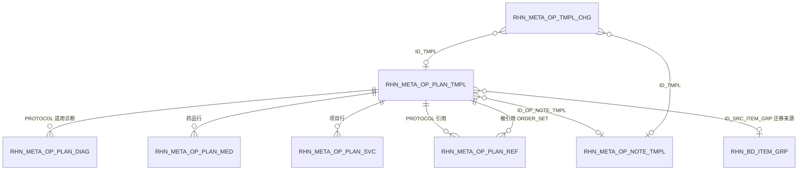

# 临床模板库融合设计（方案稿）

> 状态：P0 已实施（2026-10-25，未提交）：统一抽屉 `templates/TemplateLibraryDrawer.tsx`（由 `PlanTemplatePanel.tsx` 改名演进）按 `purpose` 打开，入口为病历区“套用模板”、医嘱区“组套 / 方案”和“临床模板”工具钮；组套查询接口已临时放开为登录可读。与第 6.2 节的差异：预览阶段只对组套做静态检查，目录、价格、库存问题在带入时发现，相应行被锁定并写入回执；重复只与当前草稿比对；每次预览只展示一个来源；医嘱录入框的组套快捷导入不变。P1a 已实施（2026-10-25，未提交）：迁移 `V1_129_65`（`SD_TMPL_KIND`、默认勾选、执行科室）与样例 `V1_129_66`；临床模板库三类页签、组套维护、医嘱区“存为组套”、检索框检出新组套、统一名称叫法、主数据组合改名。“存为组套”的候选包括待确认草稿、已随病历保存的草稿和本次已开立医嘱（已作废的排除）。已知限制：草稿上的执行科室不写入组套；草药整方一律不能存为组套，留到 P3 的草药整方组套（2026-10-25 确认）；输液成组关系按单行保存，留到 P1b。P1b、P2 未实施。本文给出病历模板、医嘱组套、诊疗方案三类临床模板“统一维护、按场景取用”的目标模型、表结构、接口、页面与分阶段迁移步骤；迁移版本号、权限编码 ID 在实施时按当时最新迁移确定。
> 归属：rhn-clinical `outpatient.template`（后端 `com.rhn.outpatient.template`，前端 `features/outpatient/templates/`、`features/outpatient/record/`、`features/outpatient/orders/`）；收费类组合继续由 rhn-platform `masterdata` 负责。
> 范围：门诊。住院、草药整方、临床路径列为后续阶段，不在一、二期实施。

## 1. 目标

1. **统一维护**：医生和管理员在“临床模板库”一个页面维护三类模板，共用范围（个人／科室／全院）、检索、启停、使用统计、失效提示和审核规则。
2. **组件化复用**：病历模板、医嘱组套作为可独立使用的组件；诊疗方案作为组合，引用组件并补充自有明细。维护一次组套，所有引用它的方案同步生效。
3. **按场景取用**：医生站只有一个模板入口，按打开位置默认过滤（写病历只看病历、开医嘱只看医嘱、下诊断后推荐方案），可整套带入，也可逐段、逐条勾选。
4. **安全带入**：带入时按当前机构、日期、目录、价格、库存、过敏和执行科室重新校验；失效条目不静默带入，也不阻断其他条目。

非目标：不改变医嘱签署、收费、发药流程；不把检验组合、检查组合、项目包等收费、执行语义并入临床模板库。

## 2. 现状与差距

### 2.1 现有能力

| 类别 | 存储 | 维护入口 | 医生站带入 | 关键实现 |
| --- | --- | --- | --- | --- |
| 病历模板 | `RHN_META_OP_NOTE_TMPL`（`JSON_CONTENT` 存 10 个病历段落及标注，`SD_DOC_TYPE`、`JSON_CONTENT_SCHEMA` 预留表单结构），范围仅 `PERSONAL`、`DEPARTMENT` | 临床模板库“病历”页签 | 病历区 `NoteTemplateBar`：按段落勾选，可选“覆盖”或“仅填空” | `OutpatientNoteTemplateService`、`record/NoteTemplateBar.tsx` |
| 诊疗方案 | `RHN_META_OP_PLAN_TMPL` + 明细 `RHN_META_OP_PLAN_DIAG`／`_MED`／`_SVC`，任务 `JSON_PLAN_TASKS`，指南 `JSON_GDLN_REF`，检索画像 `JSON_SEARCH_PROFILE`，关联一个病历模板 `ID_OP_NOTE_TMPL`；来源有手工、AI 速记、指南抽取、开方沉淀 | 临床模板库“方案”页签，`ManualClinicalTemplateDialog`、`AiPlanTemplateDraftModal` | 方案抽屉 `PlanTemplatePanel`：诊断、药品、项目、关联病历逐条勾选，药品经 `resolveTemplateOrders` 重新校验 | `OutpatientPlanTemplateService`、`templates/PlanTemplatePanel.tsx` |
| 医嘱组套 | 主数据 `RHN_BD_ITEM_GRP` + `RHN_BD_ITEM_GRP_MEMBER`，类型 `LIS`（检验组套）、`PACS`（检查组套）、`ORDER_SET`（常用组合项目）、`PACKAGE`（项目包）；成员只能是诊疗项目 | 系统设置 → 主数据 `ItemGroupDialog` | 医嘱录入检索 `ClinicalResourceSearch` 检出 `ORDER_SET`，经 `useOrderSetImport` 展开为项目草稿 | `MedicalOperationsMasterDataService`、`orders/orderSetImport.ts` |

可直接复用的机制：

- 范围与归属：`SD_SCOPE_TYPE` + `ID_OWNER`（个人＝执业人员、科室＝科室、全院＝机构），访问规则在 `requireAccessibleLocked`。
- 乐观锁 `REVISION`、`QTY_USE`／`DT_LAST_USED` 使用统计、`POST /{id}/use` 计数。
- 带入并发保护 `useTemplateApplication`：就诊、草稿或选择变化时放弃本次带入。
- 带入校验：`resolveTemplateOrders`（药品产品、包装、价格、拆分预览、过敏），`resolveOrderSetImport`（项目有效期、价格、单位、执行科室）。
- 诊断复用校验 `requireActiveDiagnosis`，检索画像 `PlanSearchProfiles`。

### 2.2 差距

1. **组套不能放药**：`ItemGroupMember` 只引用诊疗项目，常用“成药 + 检查”组合只能做成诊疗方案，组套和方案重复维护同一批项目。
2. **方案不能引用组套**：方案明细都是复制，组套调整后各方案不会同步。
3. **三个维护入口、三个带入入口**：组套在主数据维护，病历和方案在临床模板库维护；医生站分别在病历区、方案抽屉、医嘱检索里带入，交互和校验各成一套。
4. **共享模板缺少治理**：任何具备 `OUTPATIENT_RECEPTION.ACCESS` 的医生都能直接创建、修改科室或全院方案；没有审核和变更留痕。
5. **全院方案不能关联病历**：病历模板没有 `HOSPITAL` 范围，`validateNoteTemplate` 因此拒绝全院方案关联病历（`PLAN_TEMPLATE_NOTE_SCOPE_INVALID`）。
6. **组套读取依赖主数据管理接口**：医生站检索组套调用 `GET /api/platform/master-data/operations/item-groups`，该控制器整体要求 `MASTER_DATA.MANAGE`，没有该权限的医生无法检索组套。已决定（2026-10-25）：暂时去掉这个查询接口的权限要求，只需登录；写操作仍要求 `MASTER_DATA.MANAGE`。P1 由统一目录接管后，再收回这个临时放开。
7. **失效只能在带入时发现**：药品停用、项目停价、诊断失效没有维护侧提示，医生使用时才报错。

### 2.3 边界判定：哪些“组套”并入

| 主数据类型 | 业务语义 | 处理 |
| --- | --- | --- |
| `LIS` 检验组套 | 检验申请、合管、收费的组合项目；AI 检查建议经 `ItemGroupDirectory.searchOrderableGroups` 使用 | **保留在主数据**。临床模板中可以把它当作一个可开立项目引用 |
| `PACS` 检查组套 | 检查申请的组合项目 | **保留在主数据**，同上 |
| `PACKAGE` 项目包 | 收费、执行套餐 | **保留在主数据** |
| `ORDER_SET` 常用组合项目 | 医生开单快捷方式，没有独立收费或执行语义 | **迁入临床模板库**，成为 `ORDER_SET` 类型模板，并支持药品 |

判断依据：改动一个组合后，如果收费、执行或标本处理也要跟着变，就属于主数据；如果只影响医生开单时的默认勾选，就属于临床模板。

## 3. 目标模型

### 3.1 概念

```text
临床模板库（统一目录：类型、名称、范围、专科、适用诊断、关键词、状态、使用统计、来源、健康状态）
├─ NOTE       病历模板：整份病历或若干段落，可单独用于写病历
├─ ORDER_SET  医嘱组套：药品、检验、检查、治疗项目，带默认剂量、用法、数量、执行科室和默认勾选
└─ PROTOCOL   诊疗方案：适用诊断 + 引用一个 NOTE + 引用若干 ORDER_SET
                        + 自有药品、项目明细 + 随访、宣教任务 + 指南依据
```

规则：

- 只有 `PROTOCOL` 可以引用其他模板；`ORDER_SET` 和 `NOTE` 都是叶子，因此不会出现循环引用。
- `ORDER_SET` 不承载诊断和任务。需要按诊断推荐时，用名称、关键词或检索画像匹配；需要诊断时，应做成方案。
- 引用是**活引用**：方案保存的是组件 ID，带入时读取组件当前内容并实时校验。维护侧通过“被引用情况”提示影响范围，共享模板改动经审核（第 4.5 节），以此替代版本冻结。
- 引用的可见范围不得窄于方案：全院方案只能引用全院组件；科室方案可以引用本科室或全院组件；个人方案可以引用自己可见的任意组件。现有病历关联规则按此推广。

### 3.2 物理落地策略

**不新建统一大表，在现有表上渐进扩展**：

- `ORDER_SET` 与 `PROTOCOL` 都由“表头 + 药品行 + 项目行”组成，共用 `RHN_META_OP_PLAN_TMPL` 及其明细表，用新增的 `SD_TMPL_KIND` 区分。现有方案的 AI 草拟、历史挖掘、预检、检索画像代码无需迁表。
- `NOTE` 内容与病历表单结构绑定，结构完全不同，继续使用 `RHN_META_OP_NOTE_TMPL`。
- “统一目录”是应用层的聚合查询（`ClinicalTemplateCatalogService`），不是物理表。

曾考虑新建 `RHN_META_CLIN_TMPL` 统一表头、把三类内容存成 JSON。没有采用，原因有三：药品、项目行需要强类型校验，也要被统计口径引用；现有方案相关代码和数据要整体迁表，风险高；数据库规范要求核心临床事实保持强类型（`design-standard.md` 第 4 节）。

## 4. 表结构

列类型按公共迁移写法给出，Oracle 对等脚本按项目惯例映射。所有新增列和新表同步登记 `docs/foundation/rhn-physical-schema-map.json` 与 `docs/database/annotations/<表名>.json`；字段词段已核对不超过 7 个字符，未使用需登记的长词。

### 4.1 一期：组套并入与按场景取用

**`RHN_META_OP_PLAN_TMPL`（逻辑名由“门诊常用诊疗方案”调整为“门诊临床模板（组套／方案）”）新增列**

| 字段 | 类型 | 空 | 说明 |
| --- | --- | --- | --- |
| `SD_TMPL_KIND` | VARCHAR(16) | 否，默认 `PROTOCOL` | 模板类型：`PROTOCOL` 诊疗方案、`ORDER_SET` 医嘱组套。存量行回填为 `PROTOCOL` |
| `ID_SRC_ITEM_GRP` | BIGINT | 是 | 由主数据 `ORDER_SET` 迁移而来时，记录来源 `RHN_BD_ITEM_GRP.ID_ITEM_GRP`，作为迁移的幂等键 |

约束与索引：

- `CK`：`SD_TMPL_KIND in ('PROTOCOL','ORDER_SET')`。
- 唯一约束 `UK (ID_TNT, ID_ORG, ID_SRC_ITEM_GRP)`：仅对非空值生效。Oracle 用函数索引实现，H2 兼容脚本按现有可空唯一的写法处理。
- 目录查询索引 `(ID_TNT, ID_ORG, SD_TMPL_KIND, SD_STATUS)`。现有可见性查询按机构、科室、范围过滤，实施时以执行计划确认是否替换已有索引。

**`RHN_META_OP_PLAN_MED` 新增列**

| 字段 | 类型 | 空 | 说明 |
| --- | --- | --- | --- |
| `FG_DEFAULT_SELCTD` | BOOLEAN | 否，默认 true | 带入预览中是否默认勾选。用于“可选药品” |
| `SN_ORDER_GRP` | INTEGER | 是 | 模板内成组序号；序号相同的行按同组（如输液同组）带入，并复用医嘱区的输液组规则校验。为空表示不成组 |

**`RHN_META_OP_PLAN_SVC` 新增列**

| 字段 | 类型 | 空 | 说明 |
| --- | --- | --- | --- |
| `FG_DEFAULT_SELCTD` | BOOLEAN | 否，默认 true | 同上 |
| `ID_DEPT_EXEC` | BIGINT | 是 | 默认执行科室；为空时沿用 `defaultServiceExecutionDepartment`。承接 `RHN_BD_ITEM_GRP.ID_DEPT_EXEC` |

明细表约束不变：仍由父模板管理，不单独暴露并发修改入口。

### 4.2 二期：引用、治理与全院病历

**新表 `RHN_META_OP_PLAN_REF`：诊疗方案引用的医嘱组套，一行代表“某方案引用了某组套”**

| 字段 | 类型 | 空 | 说明 |
| --- | --- | --- | --- |
| `ID_OP_PLAN_REF` | BIGINT | 否 | 主键（Snowflake） |
| `ID_TNT` | BIGINT | 否 | 租户 |
| `ID_OP_PLAN_TMPL` | BIGINT | 否 | 引用方，必须是 `PROTOCOL` |
| `SN_LINE` | INTEGER | 否 | 在方案内的展示顺序 |
| `ID_REF_TMPL` | BIGINT | 否 | 被引用的模板，必须是 `ORDER_SET` |
| `FG_DEFAULT_SELCTD` | BOOLEAN | 否，默认 true | 带入时整组是否默认勾选 |
| `DES_REF` | VARCHAR(500) | 是 | 引用说明，如“血糖控制不佳时加用” |

- 外键：`(ID_TNT, ID_OP_PLAN_TMPL)`、`(ID_TNT, ID_REF_TMPL)` 均指向 `RHN_META_OP_PLAN_TMPL`，保留租户复合条件。
- 唯一约束：`(ID_TNT, ID_OP_PLAN_TMPL, ID_REF_TMPL)`、`(ID_TNT, ID_OP_PLAN_TMPL, SN_LINE)`。
- 反查索引：`(ID_TNT, ID_REF_TMPL)`，用于“被引用情况”。
- 方案与病历的一对一关联继续使用现有 `RHN_META_OP_PLAN_TMPL.ID_OP_NOTE_TMPL`，不迁入本表。

**新表 `RHN_META_OP_TMPL_CHG`：共享模板变更申请，一行代表一次提交审核的新建、修改或停用**

| 字段 | 类型 | 空 | 说明 |
| --- | --- | --- | --- |
| `ID_OP_TMPL_CHG` | BIGINT | 否 | 主键 |
| `REVISION` | BIGINT | 否 | 乐观锁 |
| `ID_TNT` / `ID_ORG` / `ID_DEPT` | BIGINT | 否 | 提交时的工作上下文 |
| `SD_TMPL_KIND` | VARCHAR(16) | 否 | `NOTE` / `ORDER_SET` / `PROTOCOL` |
| `ID_TMPL` | BIGINT | 是 | 目标模板；新建申请为空，通过后回填 |
| `SN_BASE_VER` | BIGINT | 是 | 提交时目标模板的 `REVISION`；审核通过时不一致则拒绝，需要重新提交 |
| `SD_CHG_TYPE` | VARCHAR(16) | 否 | `CREATE` / `UPDATE` / `DISABLE` |
| `SD_SCOPE_TYPE` | VARCHAR(16) | 否 | 目标范围：`DEPARTMENT` / `HOSPITAL` |
| `JSON_PAYLOAD` | CLOB | 否 | 与对应 `SaveRequest`／`UpdateRequest` 同构的完整内容；审核通过后回放到同一保存路径，同时作为版本留痕 |
| `SD_STATUS` | VARCHAR(16) | 否 | `PENDING` / `APPROVED` / `REJECTED` / `WITHDRAWN` |
| `DES_REVIEW` | VARCHAR(1000) | 是 | 审核意见 |
| `ID_RVWR` / `DT_RVWD` | BIGINT / TIMESTAMP | 是 | 审核人、审核时间 |
| `ID_USER_CREATED` / `DT_CREATED` / `ID_USER_UPDATED` / `DT_UPDATED` | — | 否 | 提交人与审计字段 |

- 索引：`(ID_TNT, ID_ORG, SD_STATUS, DT_CREATED)` 用于待审核列表；`(ID_TNT, SD_TMPL_KIND, ID_TMPL)` 用于查看模板历史。
- 主表永远只保存“已生效”的内容；草稿与待审内容只在本表，医生站不会读到未审内容。

**`RHN_META_OP_NOTE_TMPL`**：不改结构，`SD_SCOPE_TYPE` 增加允许值 `HOSPITAL`（服务端 `scope()` 白名单同步放开），解除第 2.2 节第 5 条限制。

### 4.3 关系示意



`RHN_META_OP_TMPL_CHG.ID_TMPL` 按 `SD_TMPL_KIND` 指向两张表之一，属于多态引用，不建物理外键，在 annotations 中登记为人工确认的业务关联。

## 5. 后端设计

### 5.1 模块与类

全部在 rhn-clinical `com.rhn.outpatient.template` 内，不新增跨模块依赖，只在 platform `masterdata.api` 增加两个公开方法供迁移使用。

| 类 | 职责 |
| --- | --- |
| `OutpatientPlanTemplateService`（扩展） | 按 `templateKind` 校验：`ORDER_SET` 不允许诊断、任务和病历关联，至少一条药品或项目；`PROTOCOL` 维持现有规则。二期增加引用校验与按范围的写权限判断 |
| `ClinicalTemplateCatalogService`（新） | 聚合 `NOTE` 与 `ORDER_SET`／`PROTOCOL` 的可见模板，按场景、诊断、关键词、使用频次排序，返回统一目录项；过渡期附带尚未迁移的主数据 `ORDER_SET`（只读） |
| `ClinicalTemplateExpansionService`（新） | 把一个模板展开为“病历段落 + 诊断 + 按来源分组的医嘱行”，并标注每行的健康问题；只做结构展开和目录有效性检查，价格、库存、拆分、过敏仍由前端带入解析器结合当前就诊完成 |
| `ClinicalTemplateHealthService`（新） | 按需检查：诊断（复用 `requireActiveDiagnosis`）、药品／产品／包装停用、项目停用或无有效价格、引用的组套或病历停用、执行科室失效。返回问题列表，不落库（见第 9 节待定事项） |
| `OrderSetMigrationService`（新，一期） | 把主数据 `ORDER_SET` 迁为 `ORDER_SET` 模板，支持预览、执行和幂等重跑 |
| `ClinicalTemplateChangeService`（新，二期） | 共享模板的提交、撤回、审核通过（回放 payload）、驳回 |

platform `ItemGroupDirectory` 新增：

```java
List<ItemGroupSnapshot> listOrderSetsForMigration(Long tenantId, Long organizationId, LocalDate at);
void retireMigratedOrderSets(Long tenantId, List<Long> itemGroupIds, Long actorId);
```

`retireMigratedOrderSets` 只把状态改为 `INACTIVE`，不删除数据，主数据侧保留历史与回退能力。

### 5.2 接口

**统一目录（新，一期）**：`/api/outpatient/clinical-templates`，权限 `OUTPATIENT_RECEPTION.ACCESS`。

| 方法与路径 | operationId | 说明 |
| --- | --- | --- |
| `GET /api/outpatient/clinical-templates` | `listClinicalTemplates` | 查询参数：`kinds`（可多值 `NOTE,ORDER_SET,PROTOCOL`）、`scope`（`ALL/PERSONAL/DEPARTMENT/HOSPITAL`）、`keyword`、`diagnosisCodes`（可多值，用于方案推荐排序）、`purpose`（`RECORD`/`ORDERS`/`DIAGNOSIS`/`MAINTENANCE`）、`includeHealth`（默认 false）。返回 `ClinicalTemplateCatalogEntry[]` |
| `GET /api/outpatient/clinical-templates/{kind}/{id}/expansion` | `expandClinicalTemplate` | 返回 `ClinicalTemplateExpansion`；`PROTOCOL` 合并自有行与引用组套行，并标注来源 |
| `GET /api/outpatient/clinical-templates/{kind}/{id}/usages` | `listClinicalTemplateUsages` | 被哪些方案引用（二期生效；一期对病历返回关联它的方案） |

`purpose` 只决定默认的类型过滤和排序，不改变可见性：

| purpose | 默认类型 | 排序要点 |
| --- | --- | --- |
| `RECORD` | `NOTE`，以及包含病历的 `PROTOCOL` | 本人使用频次、专科匹配 |
| `ORDERS` | `ORDER_SET`，以及包含医嘱的 `PROTOCOL` | 本人使用频次 |
| `DIAGNOSIS` | `PROTOCOL` | 诊断编码匹配度（复用 `PlanSearchProfile`）、使用频次 |
| `MAINTENANCE` | 全部 | 范围、更新时间；支持只看有问题的模板 |

**目录项契约**

```text
ClinicalTemplateCatalogEntry {
  kind: NOTE | ORDER_SET | PROTOCOL
  id, revision, name, description, scopeType, ownerId, specialtyCode?
  origin: TEMPLATE | LEGACY_ITEM_GROUP          // 过渡期：未迁移的主数据组套只读展示
  sourceType?                                    // MANUAL / AI_INPUT / AI_GUIDELINE / AI_MINED / ITEM_GROUP
  summary?, keywords[], diagnoses[{code, display}]
  parts { noteFields: int, diagnoses: int, medications: int, services: int, orderSetRefs: int, tasks: int }
  useCount, lastUsedAt, updatedAt
  health?: { level: OK | WARN | INVALID, issues[{code, lineRef?, message}] }
}
```

**展开结果契约**

```text
ClinicalTemplateExpansion {
  template: ClinicalTemplateCatalogEntry
  note?: { templateId, revision, content: OutpatientNoteTemplateContent }
  diagnoses: OutpatientPlanTemplateDiagnosisView[]
  orderGroups: [{
    source: { kind: PROTOCOL | ORDER_SET, templateId, revision, name, defaultSelected, refDescription? }
    medications: (OutpatientPlanTemplateMedicationView + defaultSelected, orderGroupNo?)[]
    services:    (OutpatientPlanTemplateServiceView + defaultSelected, executionDepartmentId?)[]
  }]
  tasks: OutpatientPlanTemplatePlanTaskInput[]
  health: { level, issues[] }
}
```

**类型化维护接口（扩展现有）**

- `/api/outpatient/plan-templates`：`SaveRequest`、`UpdateRequest`、`View` 增加 `templateKind`（缺省 `PROTOCOL`，兼容旧客户端），`MedicationInput` 增加 `defaultSelected`、`orderGroupNo`，`ServiceInput` 增加 `defaultSelected`、`executionDepartmentId`。`GET` 增加可选 `kind` 参数，缺省只返回 `PROTOCOL`，保持现有页面行为不变。二期在 `SaveRequest`、`UpdateRequest`、`View` 增加 `orderSetRefs: [{templateId, defaultSelected, description}]`。
- `/api/outpatient/note-templates`：二期接受 `scopeType=HOSPITAL`。
- 现有构造器重载继续保留，避免 AI 草拟、挖掘转换等调用方一次性改动。

**组套迁移（新，一期）**：权限 `CLINICAL_TEMPLATE.MANAGE`。

| 方法与路径 | 说明 |
| --- | --- |
| `GET /api/outpatient/clinical-templates/migrations/item-group-order-sets` | 预览当前机构可迁移的主数据 `ORDER_SET`：将新建、已迁移（跳过）、无法迁移及原因 |
| `POST /api/outpatient/clinical-templates/migrations/item-group-order-sets` | 请求体 `{itemGroupIds[], retireSource: boolean}`；逐组独立事务执行，返回逐组结果 |

**共享模板治理（新，二期）**：

| 方法与路径 | 权限 | 说明 |
| --- | --- | --- |
| `POST /api/outpatient/clinical-templates/changes` | `OUTPATIENT_RECEPTION.ACCESS` | 提交新建、修改或停用申请 `{kind, templateId?, baseRevision?, changeType, scopeType, payload}` |
| `GET /api/outpatient/clinical-templates/changes?status=&mine=` | 提交人看自己的；审核人看待审 | 列表，含与当前生效内容的差异摘要 |
| `POST /api/outpatient/clinical-templates/changes/{id}/withdraw` | 提交人 | 撤回 |
| `POST /api/outpatient/clinical-templates/changes/{id}/approve` | `CLINICAL_TEMPLATE.REVIEW`（科室）／`CLINICAL_TEMPLATE.MANAGE`（全院） | 校验 `baseRevision` 后回放 payload，生效 |
| `POST /api/outpatient/clinical-templates/changes/{id}/reject` | 同上 | 驳回，必填意见 |

所有接口变更后重新生成 `docs/api/openapi.json` 与前端 `generated.ts`。

### 5.3 权限

| 权限 | 新／旧 | 能力 |
| --- | --- | --- |
| `OUTPATIENT_RECEPTION.ACCESS` | 现有 | 读取可见模板；维护个人模板；二期起对科室、全院模板只能提交申请 |
| `CLINICAL_TEMPLATE.REVIEW` | 新，二期 | 审核本人当前工作科室的科室模板申请 |
| `CLINICAL_TEMPLATE.MANAGE` | 新，一期 | 直接维护和发布科室、全院模板；审核全院申请；执行组套迁移 |

权限通过迁移写入 `RHN_SYS_ACC_PERM`，写法参照 `V1_129_15__billing_relief_policy.sql`。一期新增 `MANAGE` 时，共享模板写入仍保持现状（所有医生可写），避免上线即收紧；二期启用审核时，存量共享模板保持 `ACTIVE`，只有新的写操作走申请流程。默认角色授予方案在实施时与业务确认。

### 5.4 业务错误码

沿用 `BusinessErrors`，一种可区分的失败对应一个稳定 code：

| code | 类型 | 场景 |
| --- | --- | --- |
| `CLINICAL_TEMPLATE_KIND_INVALID` | badRequest | 类型不在允许值内，或类型与接口不匹配 |
| `ORDER_SET_EMPTY` | badRequest | 组套没有任何药品或项目 |
| `ORDER_SET_CONTENT_INVALID` | badRequest | 组套带了诊断、任务、病历关联或引用 |
| `PLAN_TEMPLATE_REF_KIND_INVALID` | badRequest | 被引用模板不是 `ORDER_SET` |
| `PLAN_TEMPLATE_REF_SCOPE_INVALID` | badRequest | 被引用组套的可见范围窄于方案 |
| `PLAN_TEMPLATE_REF_FORBIDDEN` | forbidden | 当前工作上下文看不到被引用组套 |
| `PLAN_TEMPLATE_REF_INACTIVE` | conflict | 保存时被引用组套已停用 |
| `ORDER_SET_REFERENCED` | conflict | 停用仍被生效方案引用的组套，且未带 `confirmReferenced=true` |
| `CLINICAL_TEMPLATE_REVIEW_REQUIRED` | forbidden | 二期无 `MANAGE` 权限直接写共享模板，提示改为提交申请 |
| `CLINICAL_TEMPLATE_CHANGE_STALE` | conflict | 审核时目标模板已被他人修改 |
| `CLINICAL_TEMPLATE_CHANGE_STATE_INVALID` | conflict | 对非 `PENDING` 申请执行审核或撤回 |
| `CLINICAL_TEMPLATE_REVIEW_FORBIDDEN` | forbidden | 审核人不具备对应范围的审核权限 |
| `ORDER_SET_MIGRATION_NOT_ELIGIBLE` | conflict | 组套不满足迁移条件（第 7.2 节） |

## 6. 前端设计

名称与范围叫法以第 7.1.1 节的统一约定为准。

### 6.1 维护端：临床模板库（`/outpatient/plan-templates`，菜单名不变）

在现有 `OutpatientPlanTemplatesWorkspace`（`MasterDetailPage`）上改造，不新开页面：

- **左栏目录**：把“病历／方案”两个页签改为类型筛选（全部／诊疗方案／医嘱组套／病历模板）；保留范围筛选与搜索；新增“只看有问题”。列表行显示类型、范围、健康状态标记、使用次数。
- **右栏详情**按类型展示：
  - 病历模板：沿用 `NoteWritingTemplateEditor` 的只读预览与编辑。
  - 医嘱组套：药品区、项目区，复用 `PlanTemplateClinicalEditor` 的药品、项目编辑能力，隐藏诊断和任务；每行可设“默认勾选”，药品可设成组序号，项目可设执行科室。
  - 诊疗方案：现有内容，二期增加“引用组套”区（检索 `ORDER_SET`、排序、默认勾选、说明），以及合并后的医嘱预览（按来源分组）。
  - 通用侧栏：被引用情况、健康问题、使用统计、来源（手工、AI、指南、挖掘、主数据迁移）。
- **操作**：新建（先选类型）、复制为个人、编辑、停用（被引用时弹出影响列表并二次确认）、二期增加提交审核和变更记录。
- **待审核**（二期）：具备审核权限时显示“待审核”视图，左侧为申请列表，右侧为生效内容与申请内容的逐段、逐行差异，可通过或驳回。
- **组套迁移**（一期，仅 `MANAGE`）：一次性管理入口，表格预览“将新建／已迁移／无法迁移”，勾选后执行并展示逐组结果。

### 6.2 医生站：一个入口，按场景过滤

把 `PlanTemplatePanel` 演进为 `TemplateLibraryDrawer`，增加 `purpose` 属性，继续挂在现有的 `planTemplateDrawerHost` 上，各入口只是以不同 `purpose` 打开：

| 入口位置 | 触发 | purpose | 默认展示 |
| --- | --- | --- | --- |
| 病历区模板按钮（替换 `NoteTemplateBar` 的选择弹层，保留“存为模板”） | 医生点击 | `RECORD` | 病历模板与方案的病历部分；预览按段落勾选，覆盖／仅填空沿用现有规则 |
| 医嘱区“组套／方案”按钮 | 医生点击 | `ORDERS` | 组套与方案的医嘱部分 |
| 医嘱录入检索框 | 输入关键词 | `ORDERS` | `ClinicalResourceSearch` 的组套数据源改为统一目录 `kinds=ORDER_SET`；选中后不立即展开，打开抽屉预览确认 |
| 诊断确认后的推荐条 | 新增或修改诊断 | `DIAGNOSIS` | 匹配度最高的若干方案；已有 AI 推荐 `recommendedPlanId` 继续作为初始选中项 |
| 方案抽屉（现有入口） | 医生点击 | `DIAGNOSIS` | 全部类型，可切换 |

**带入预览**分三个区，每区都有“全选／全不选”：

1. **病历**：按段落勾选，覆盖／仅填空开关。
2. **诊断**：与当前诊断按编码去重，已存在的标为“已有”且不勾选；主诊断冲突沿用现有 `PlanTemplatePanel` 规则。
3. **医嘱**：按来源分组（方案自有、组套 A、组套 B……），每组可整组勾选，组内逐行勾选。
   - `defaultSelected=false` 的行初始不勾选。
   - 与当前医嘱草稿、已开立医嘱或其他来源重复的行（药品按 `medicationId + catalogItemId`，项目按 `catalogItemId`）标为“重复”，初始不勾选。
   - 有健康问题的行置灰并显示原因，不可勾选；其他行照常带入。
   - 同组药品整组勾选或取消。

**带入执行**：

- 统一调用一个解析器：`resolveTemplateOrders` 扩展支持项目行的执行科室和有效期校验，吸收 `resolveOrderSetImport` 的项目校验逻辑，后者在迁移完成后删除。全程继续由 `useTemplateApplication` 保护并发。
- 完成后，提示“已带入 N 项，跳过 M 项（原因）”，沿用 `templateApplicationReceipt`。
- 对实际带入的方案和每个被带入的组套各调用一次 `POST /{id}/use`；病历模板沿用现有计数。

**存为模板**：当前就诊可以“存为模板”，弹窗选择存为病历模板、医嘱组套或诊疗方案（三选一），以及勾选范围（段落、医嘱行）。保存逻辑复用 `maintainedTemplateSave`、`noteTemplateSaveInput`。选择科室或全院范围时，二期改为提交申请。

### 6.3 主数据端

- P1a 改名：“项目组套”→“项目组合”，检验组套、检查组套 → 检验组合、检查组合（第 7.1.1 节）。
- P1b 迁移完成后，`ItemGroupDialog` 类型下拉不再提供 `ORDER_SET`；列表中已停用的 `ORDER_SET` 显示“已迁至临床模板库”并提供跳转。
- `LIS`、`PACS`、`PACKAGE` 的维护功能不变。

### 6.4 前端文件规划

| 文件 | 变化 |
| --- | --- |
| `shared/api/clinicalTemplatesApi.ts`（新） | 目录、展开、引用情况、迁移、变更申请接口封装；入参出参使用 `generated.ts` 类型 |
| `features/outpatient/templates/TemplateLibraryDrawer.tsx`（由 `PlanTemplatePanel.tsx` 演进） | `purpose`、统一预览、按来源分组 |
| `features/outpatient/templates/OrderSetEditor.tsx`（新） | 组套编辑，复用 `PlanTemplateClinicalEditor` 的子区块 |
| `features/outpatient/templates/ProtocolOrderSetRefs.tsx`（新，二期） | 方案引用组套 |
| `features/outpatient/templates/TemplateReviewQueue.tsx`（新，二期） | 待审核与差异 |
| `features/outpatient/templates/OrderSetMigrationPanel.tsx`（新，一期） | 组套迁移 |
| `features/outpatient/templates/resolveTemplateOrders.ts` | 吸收项目行校验 |
| `features/outpatient/record/NoteTemplateBar.tsx` | 选择弹层改为以 `RECORD` 打开抽屉 |
| `shared/ui/ClinicalResourceSearch.tsx` | 组套数据源改为统一目录 |
| `features/outpatient/orders/orderSetImport.ts`、`useOrderSetImport.ts` | 迁移完成后删除 |
| `features/settings/operations/ItemGroupDialog.tsx` | 移除 `ORDER_SET` 新建选项 |
| `features/outpatient/record/README.md`、`orders/README.md` | 更新入口说明 |

## 7. 迁移与上线步骤

### 7.1 分阶段

| 阶段 | 内容 | 是否改表 | 验证 |
| --- | --- | --- | --- |
| **P0** 统一带入入口 | 前端把病历模板、方案、组套带入合并为 `TemplateLibraryDrawer` + `purpose`；数据源仍为现有三个接口；预览按“病历／诊断／医嘱”分区，按来源分组；统一带入回执 | 否 | `./scripts/verify-scope.sh round1 --frontend-only` |
| **P1a** 医生可用的组套（2026-10-25 调整为先做） | 见第 7.1.1 节：`SD_TMPL_KIND` 与行级默认勾选、执行科室；临床模板库增加“医嘱组套”；医嘱区“存为组套”；统一名称与范围叫法；主数据组合改名 | 是 | `./scripts/verify-scope.sh round1,master-data`（自动追加 api-contract）；迁移追加 `npm --prefix frontend run schema:refresh -- --source expected` 与 `schema:check`；含迁移，合并前按规则说明后执行 `--full` |
| **P1b** 旧组套迁移与统一目录 | 主数据 `ORDER_SET` 迁移工具与 `ID_SRC_ITEM_GRP`（第 7.2 节）；统一目录与展开接口；`SN_ORDER_GRP` 成组；`SD_SOURCE_TYPE` 白名单与 `ITEM_GROUP`；`CLINICAL_TEMPLATE.MANAGE` 权限；迁移完成后收回第 2.2 节第 6 条的临时放开、删除 `orderSetImport` | 是 | `./scripts/verify-scope.sh round1,master-data`（自动追加 api-contract）；迁移追加 `npm --prefix frontend run schema:refresh -- --source expected` 与 `schema:check`；含迁移和权限，合并前按规则说明后执行 `--full` |
| **P2** 引用与治理 | `RHN_META_OP_PLAN_REF`、`RHN_META_OP_TMPL_CHG`；方案引用组套；健康检查与“只看有问题”；共享模板审核；病历模板支持全院范围；`CLINICAL_TEMPLATE.REVIEW` 权限 | 是 | 同 P1，追加 `ai-matching`（方案预检和 AI 转换会读取方案结构） |
| **P3** 扩展 | 住院复用（对接 `InpatientMedicalRecordTemplates`）、草药整方组套、轻量临床路径（按天的方案序列） | 待定 | 另行设计 |

P0 除第 2.2 节第 6 条的临时权限放开外不改后端，用来先验证交互。统一抽屉直接聚合三类数据源，组套通过 `itemGroups(…, 'ORDER_SET', 'ACTIVE')` 读取；医嘱录入框的组套快捷导入在 P0 保持不变。

### 7.1.1 P1a 范围明细

目标：医生在一个地方维护组套，并能在看病过程中直接把当前医嘱存为组套；医生看不到“主数据”这个概念。

**统一名称与范围叫法**（医生可见文案全部统一，维护页、抽屉、按钮、提示一致）：

| 概念 | 医生看到的名称 | 一句话说明（新建时显示） |
| --- | --- | --- |
| `PROTOCOL` | 诊疗方案 | 病历、诊断、医嘱一整套，按诊断推荐 |
| `ORDER_SET` | 医嘱组套 | 一次开一组药品或检查治疗 |
| `NOTE` | 病历模板 | 快速填写病历段落 |
| `PERSONAL` / `DEPARTMENT` / `HOSPITAL` | 我的 / 科室 / 全院 | — |

页签和筛选顺序固定为“诊疗方案、医嘱组套、病历模板”。原范围页签“个人高频 / 科室路径 / 全院/指南”改为“我的 / 科室 / 全院”；“开方沉淀”（`MINED`）只在诊疗方案下作为来源筛选保留。

**后端**：

- 迁移：第 4.1 节的 `SD_TMPL_KIND`、`RHN_META_OP_PLAN_MED.FG_DEFAULT_SELCTD`、`RHN_META_OP_PLAN_SVC.FG_DEFAULT_SELCTD` 与 `ID_DEPT_EXEC`。`ID_SRC_ITEM_GRP`、`SN_ORDER_GRP` 留到 P1b。
- `/api/outpatient/plan-templates` 按第 5.2 节增加 `templateKind`、`kind` 查询参数（缺省 `PROTOCOL`）、行级 `defaultSelected`、`executionDepartmentId`；`ORDER_SET` 校验与错误码 `CLINICAL_TEMPLATE_KIND_INVALID`、`ORDER_SET_EMPTY`、`ORDER_SET_CONTENT_INVALID`。
- 方案专用的下游一律只读 `PROTOCOL`：AI 方案推荐、历史挖掘、方案预检、`PlanTemplateSnapshot` 等对外目录不得混入组套。
- 共享范围写入沿用现状（P2 才引入审核）。

**前端**：

- 临床模板库：三类页签；“新建”先选类型并显示一句话说明；医嘱组套详情与编辑（药品、项目两区，每行默认勾选，项目可选执行科室）；停用、复制为我的。主数据里尚未迁移的“常用组合项目”在医嘱组套页签只读展示，标注“全院 · 由医务科维护”，不出现编辑按钮。
- 医嘱区“存为组套”：在“组套 / 方案”旁新增按钮，弹窗列出当前医嘱草稿（默认全选，可取消），填写名称、选择范围（默认“我的”），保存为 `ORDER_SET`；保存成功后抽屉与检索立即可见。
- 统一模板抽屉：医嘱组套同时读取新 `ORDER_SET` 模板与旧主数据组合；范围与类型叫法按上表统一。
- 医嘱录入框检索：同时检出新组套；选中新组套打开抽屉预览（`ORDERS`），旧主数据组合暂保持原快捷导入。

**主数据改名**（只改医生和管理员可见文案，不改编码）：菜单区域“项目组套”改为“项目组合”；`LIS` 检验组套 → 检验组合，`PACS` 检查组套 → 检查组合，`PACKAGE` 项目包不变，`ORDER_SET` 常用组合项目 → “常用组合项目（将迁至临床模板库）”；相关提示、错误文案中的“组套”同步改为“组合”。从此“组套”一词只指医生使用的医嘱组套。

### 7.2 P1b 组套数据迁移规则

迁移由 `OrderSetMigrationService` 在管理员的工作上下文（机构 + 科室）中执行，不写成 SQL 数据迁移，原因有两个：主键需要 Snowflake 生成；项目名称、编码、类型需要从当前目录读取快照并校验。

**纳入条件**（不满足的在预览中列为“无法迁移”并给出原因）：

- `SD_GRP_TYPE='ORDER_SET'`，`SD_STATUS='ACTIVE'`，在今天有效（`DA_VALID_FROM <= 今天`，且 `DA_VALID_TO` 为空或不早于今天）；
- `ID_ORG` 为当前机构或为空（为空表示全租户通用：按机构逐个迁移，每个机构各得一份，幂等键为 `(ID_TNT, ID_ORG, ID_SRC_ITEM_GRP)`）；
- `SD_USAGE_TYPE` 为空、`COMMON` 或 `OUTPATIENT`；
- 每个成员在当前机构目录中能唯一确认，且项目仍然有效。

**字段映射**：

| 来源 | 目标 |
| --- | --- |
| `RHN_BD_ITEM_GRP` | `RHN_META_OP_PLAN_TMPL`：`SD_TMPL_KIND='ORDER_SET'`、`SD_SCOPE_TYPE='HOSPITAL'`、`ID_OWNER=当前机构`、`ID_DEPT=执行人当前科室`、`NA_TMPL=NA_ITEM_GRP`、`DES_OP_PLAN_TMPL` 注明“由主数据组套 {CD_ITEM_GRP} 迁移”、`SD_SOURCE_TYPE='ITEM_GROUP'`、`ID_SRC_ITEM_GRP=ID_ITEM_GRP` |
| `ID_DEPT_EXEC` | 每个项目行的 `ID_DEPT_EXEC` |
| `RHN_BD_ITEM_GRP_MEMBER` | `RHN_META_OP_PLAN_SVC`：`SN_LINE=SN_SORT`、`ID_CATALOG_ITEM`、项目编码、名称、类型取当前目录快照，`QTY_ORDERED=QTY_MEMBER`，`CD_UNIT` 取成员单位（为空时取目录单位），`DES_CLIN_DESCR=DES_MEMBER_DESCR`，`FG_DEFAULT_SELCTD=true`（现有导入会展开全部成员，迁移后保持一致），定价相关字段按 `ServiceInput` 现有默认规则计算 |
| `FG_RQD_MEMBER`、`FG_POINT_OF_CARE` | 没有对应字段；为 true 时在预览中提示，供人工确认是否需要调整默认勾选 |

`SD_SOURCE_TYPE` 现为服务端未约束的自由取值（现有 `MANUAL`、`AI_INPUT`、`AI_GUIDELINE`、`AI_MINED`），新增 `ITEM_GROUP` 后同步前端来源标签；P1 顺带在服务端加白名单校验。

**执行**：

1. 上线 P1 迁移脚本与代码。统一目录在过渡期把“尚未迁移”的主数据 `ORDER_SET` 作为 `origin=LEGACY_ITEM_GROUP` 只读项返回，医生站检索不出现空窗。
2. 管理员在临床模板库打开“组套迁移”，逐机构预览后执行；勾选 `retireSource=true` 时，迁移成功的来源组套由 `retireMigratedOrderSets` 置为 `INACTIVE`。
3. 每组独立事务，失败不影响其他组；重跑时按幂等键跳过已迁移项。
4. 全部机构迁移完成并观察一个版本周期后，在下一版本移除 `LEGACY_ITEM_GROUP` 兼容读取、`orderSetImport.ts` 和主数据中 `ORDER_SET` 的新建入口。

**回退**：迁移不删除主数据。回退时停用迁移生成的 `ORDER_SET` 模板（`ID_SRC_ITEM_GRP` 非空），在主数据中把来源组套恢复为 `ACTIVE`，并恢复兼容读取开关。

### 7.3 结构迁移注意事项

- 新迁移的版本号高于实施时最新版本（当前最新为 `V1_129_57`），公共、Oracle、H2 兼容脚本成对提交，不改写已发布迁移。
- `SD_TMPL_KIND` 用“加列 + 默认值 + 回填 + 非空约束”三步写法，保证存量行和并行任务的数据安全。
- 同步更新物理映射与 annotations。统计语义 `outpatient-ontology.v1.yaml` 目前没有引用模板表，无需改动；今后如果统计模板使用量，须按 `SD_TMPL_KIND` 区分方案与组套。
- local、oracle-local 样例数据补充至少一个组套、一个引用组套的方案、一个全院病历模板，便于人工验收。

## 8. 测试与验收

**后端**（`test` profile、随机 H2）：

- 组套保存：拒绝诊断、任务、病历关联与引用；空组套被拒；行级默认勾选、成组序号、执行科室能保存并原样读回。
- 可见性与范围：个人、科室、全院在跨科室、跨机构上下文中的可见性；方案引用组套的范围收窄规则。
- 展开：方案自有行与引用行的来源标注、顺序、默认勾选；引用组套停用后的健康问题与跳过。
- 迁移：预览分类、幂等重跑、全租户组套按机构展开、部分失败隔离、来源停用、回退。
- 治理：提交、撤回、通过（回放并生效）、过期驳回（`CHANGE_STALE`）、无权审核、主表不出现未审内容。
- 权限：`MANAGE`、`REVIEW` 边界；二期前后共享模板写入行为的差异。

**前端**（vitest）：

- `TemplateLibraryDrawer` 各 `purpose` 的默认过滤、预览分区、重复和失效行处理、整组勾选、上下文变化时放弃带入。
- `resolveTemplateOrders` 吸收项目校验后，覆盖原 `orderSetImport.test.ts` 的全部断言。
- 临床模板库的类型筛选、组套编辑器、被引用确认、迁移面板、审核差异。

**人工验收**（`oracle-local`，1280／1440／1920px）：

1. 管理员迁移主数据组套，医生站检索组套，带入结果与迁移前一致。
2. 维护“2 型糖尿病复诊”方案：关联病历模板、引用“糖尿病常规检验”组套、自有二甲双胍；医生站下诊断后被推荐，取消一项检验后带入。
3. 停用被引用的组套，方案详情与医生站预览都提示该组失效，其他部分仍可带入。
4. 普通医生修改科室方案，提交申请；审核人通过后，医生站看到新内容。

## 9. 待定事项

| 事项 | 建议 | 需要谁确认 |
| --- | --- | --- |
| 引用采用活引用还是快照 | 活引用 + 被引用提示 + 共享模板审核（本文方案）；如果后续要求方案冻结组件版本，可在 `RHN_META_OP_PLAN_REF` 增加 `SN_REF_VER` 并从变更申请中取历史内容 | 医务科、信息科 |
| 健康状态是否落库 | 先按需计算；模板量大、目录列表变慢时，再增加定时巡检并落库，所需调度能力届时另行评估 | 开发 |
| `PACKAGE`、`LIS`、`PACS` 组合能否作为组套中的一行 | 可以，作为可开立项目引用，展开、收费逻辑仍由主数据和医嘱侧负责；一期只支持单个诊疗项目 | 医务科 |
| 默认角色授予 `CLINICAL_TEMPLATE.REVIEW`、`MANAGE` | 科主任授予 `REVIEW`，医务科授予 `MANAGE` | 医务科 |
| 二期是否强制启用审核 | 用分层参数控制，按机构开启 | 医务科 |
| 住院与草药整方 | 进入 P3，单独设计 | 产品 |
