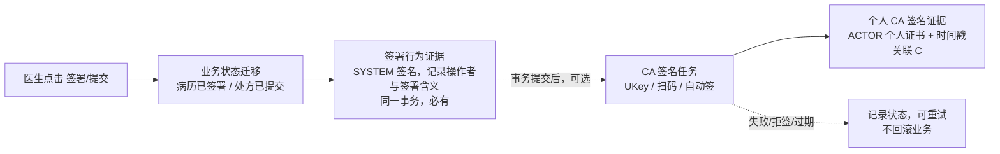
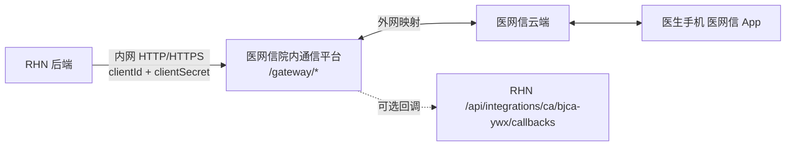
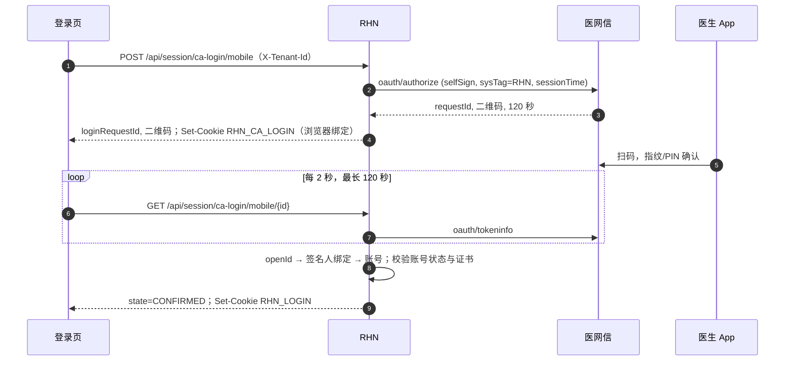
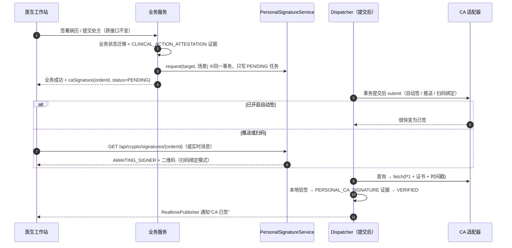

# 通用 CA 集成功能设计（UKey / 扫码认证 / 业务数字签名）

- 状态：设计稿 v2，待评审
- 日期：2026-10-18
- 关联：[ADR-002 认证与授权](架构决策-002-认证与授权.md)、[ADR-003 密码证据](架构决策-003-密码证据.md)、[ADR-004 分层参数](架构决策-004-分层参数配置.md)、[安全基线](../安全基线.md)、[建设路线图](../建设路线图.md)

## 0. 已确认决策（2026-10-18）

| # | 事项 | 决策 | 对设计的影响 |
|---|---|---|---|
| 1 | 厂商 | 调研头部厂商形成通用接口，选一家实际接入 | 第 3 节调研、第 5 节通用接口、第 7 节以**数字认证（BJCA）旗下的医网信院内移动签名**为接入案例 |
| 2 | 优先级 | 先做登录和门诊场景 | 一期：扫码登录、UKey 登录、门诊病历、门诊处方、门诊审方；住院、报告签章等后移 |
| 3 | CA 定位 | **CA 只是一种可选签名方式，不作为进入下一流程的前提** | 业务签署/提交与 CA 签名解耦：业务照常完成，CA 签名作为附加证据异步补上；CA 故障不影响诊疗。原“应急补签”机制不再需要 |
| 4 | 证书登录 | 不强制 | 证书/扫码登录是可选登录方式；但等保三级要求双因子，见第 9 节 |
| 5 | 患者签名 | 不纳入 | 删除患者签名、知情同意相关设计 |
| 6 | BouncyCastle | 同意引入 | 后端用 `bcprov`/`bcpkix` 实现 SM2/SM3、P7 解析、证书链校验，以及开发环境模拟 CA |
| 7 | 合规目标 | 等保三级；关键数据为**口令等鉴别数据**和**患者敏感信息** | 个人 CA 签名不进入必选密码保护目录，ADR-003 需同步修订（第 4.2 节）；鉴别数据和患者敏感信息的保护单独立项（第 9 节） |

> 第 7 项按“关键数据目录 = 鉴别数据 + 患者敏感个人信息”理解。如果“密码”另有所指（例如整体密评范围），需回改第 4.2 节和第 9 节。

## 1. 目标与边界

**目标**

1. 一套平台能力适配多家 CA：新增厂商只写适配器和配置，业务代码不变。
2. 支持两种个人身份介质：**UKey** 和 **手机扫码（协同签名 / 云证书）**，用于登录和业务签名。
3. 门诊关键行为（病历签署、处方提交、药师审方）可附加**个人证书签名 + 可信时间戳**，形成可独立验证的证据。
4. CA 是增强能力，不是业务前提：CA 不可用、医生没有证书、医生选择跳过时，诊疗流程完全照常。

**非目标**

- 不自建 CA，不在 RHN 服务端保存人员私钥或 PIN。
- 不做患者签名、知情同意书和 PDF 手写签章。
- 不在本文完成鉴别数据和患者敏感信息加密的详细设计，只给出约束（第 9 节）。

## 2. 现状评估（基于当前代码）

| 能力 | 现状 | 差距 |
|---|---|---|
| 密码证据底座 | `platform.cryptography`：`protect / verify / requireValid`；追加式 `RHN_AUD_CRYPTO_EVID`；声明 `RHN-EVIDENCE-JSON-1`；证据链；合规门禁 | `CryptographicProvider.sign()` 是同步、服务端持钥模型，接不了 UKey（私钥在医生电脑）和扫码签名（异步）。**生产没有可用提供者**：`active-provider` 为空时 `protect()` 直接失败，病历创建/签署在生产无法完成 |
| 业务签署 | 病历 `ClinicalDocumentService.sign` 写 `CLINICAL_DOCUMENT_SIGNATURE`（要求个人证书）；交接班同理 | 这把“业务签署”和“个人证书签名”绑成了一件事，与决策 3 冲突，需要拆开 |
| 门诊入口 | `PrescriptionController POST /{id}/submit`、`PharmacyApplicationService.review` 未接入证据 | 需要接入签署行为证据，并允许附加 CA 签名 |
| 认证 | HTTP Basic（仅本地/测试）+ `RefreshLoginSessionService`（`RHN_LOGIN` Cookie）+ 会话吊销；口令 BCrypt；登录审计 `RHN_AUD_IAM_AUTH_EVT` | 没有扫码/证书登录，没有双因子 |
| 可复用 | 收费 `PaymentChannelAdapter` + `PaymentChannelRegistry`（能力声明、唯一性校验、按机构选配置、凭据不外露）；`SecretEncryptionService`；`DomainEventPublisher` 和 Outbox；`RealtimePublisher`；`ConfigurationDirectory` | 适配器注册、凭据保护、异步派发、结果推送、分层配置都直接复用 |

## 3. 厂商调研

### 3.1 头部厂商与产品形态

| 厂商 | 医疗相关产品 | 通道 | 公开资料 | 备注 |
|---|---|---|---|---|
| 数字认证 BJCA（含子公司数字医信） | 医网信 / 医网签（院内移动签名、云签名）、证书应用环境（UKey） | 扫码登录（OAuth）、推送签名、PC 二维码签名、扫码绑定签名、授权自动签、断网本地授权、UKey | **院内版接口文档公开**（[doc.51trust.com](https://doc.51trust.com/)），含 50 余个电子病历摘要模板 | 院内部署“通信平台”，对内提供接口，对外映射接收云端回调，带断网缓存补推 |
| 上海 CA（SHECA） | 医疗移动签名、协同签名、“大家签”，UKey | UKey、扫码签名、移动端签名 | 只有方案和案例页（瑞金、中山医院等），无公开 API | 需向厂商索取 SDK |
| CFCA | 云证签 App、CryptoKit 浏览器扩展 | 扫码签名、移动证书、UKey/浏览器扩展 | 只有 App 和扩展说明 | 金融领域为主，医疗案例较少 |
| 吉大正元 | 医慧签 | 移动签署病历、处方、报告 | 只有 App 描述 | 需索取接口 |
| 深圳小信科技 | 医信签 | 扫码登录、扫码签署（含小程序、企业微信、钉钉） | 只有产品页 | 对接第三方 CA 签发移动证书 |
| e签宝 | 医签宝 | 意愿认证 + 云端签署 | 开放平台通用 API 公开，医疗专用接口需单独确认 | 偏电子合同模式 |

### 3.2 共性抽象

各家的名词不同，但流程可以归为几类相同的概念。通用接口按这些概念设计：

| 通用概念 | 医网信（院内版） | 其他厂商常见叫法 | RHN 端口（第 5 节） |
|---|---|---|---|
| 签名人备案 | `synDoctor` → `openId`；`synDoctorSearch` 查状态（`process=2` 才可签） | 用户注册 / 实名开户 / 证书申请 | `SignerEnrollmentPort` |
| 扫码登录 | `oauth/authorize` 返回 `requestId` 和二维码（120 秒），轮询 `oauth/tokeninfo` | 移动认证 / 扫码认证 | `MobileLoginPort` |
| 签名任务 | `recipe/synRecipeInfo`（`hash_xxx` 模板 + `hashValue`）→ `uniqueId` | 签名订单 / 签名流水 / signJob | `RemoteSigningPort.submit` |
| 签名方式 | `signType` 0 推送、4 扫码绑定；PC 二维码 | 推送签 / 扫码签 | `SigningMode` |
| 授权自动签 | `selfSign/request`、`getResult`、`quit`；登录时也可带 `selfSign=true`，会话时长 1–24 小时 | 免密签 / 授权签 / 托管签 | `SigningGrantPort` |
| 结果回收 | 回调（失败每 5 分钟重试，最多 5 次）+ `querySignDataByUniqueId` / `batchQueryOrderStatus`（每批 ≤100）+ `synSignDataSearch`（P7，或 P1 + 证书） | 回调 + 主动查询 | `RemoteSigningPort.query/fetch` + `CallbackTranslator` |
| 终态 | 2 已签、6 拒签、7 过期（7 天）、8 删除、9 签后在 App 作废、10 未领取 | 各家不同 | 统一映射为 `SigningOrderStatus` |
| 验签 / 时间戳 | `verifyDataById`、`verifyTimeStamp`、`verifyTimeSign` | 签名验签服务器 / TSA | `VerificationPort`；同时本地用 BouncyCastle 独立校验 |
| UKey | 证书应用环境（本地服务，接口需厂商文档） | SKF / SOF 中间件、浏览器扩展 | 前端 `ClientTokenDriver` + 后端 `ClientSignatureVerifier` |

### 3.3 选择医网信作为接入案例的理由

1. **公开文档最完整**：从备案、登录、签名、回调到验签、时间戳都有公开的字段级说明，可以先按文档开发，再申请测试环境联调。
2. **为医疗设计**：摘要模板直接对应病历类别（`hash_002` 门急诊病历、`hash_004` 西药处方、`hash_005` 中药处方、`hash_006` 检查报告、`hash_007` 检验报告等）。可以只签摘要，原文不出院。
3. **能力覆盖门诊一期**：扫码登录、登录时开启自动签、推送签、扫码绑定签、批量查询都有。
4. **院内部署**：通信平台部署在院内，业务系统只访问内网地址；断网时自动缓存，恢复后补推。
5. **同一厂商还有 UKey 产品**（证书应用环境），后续接 UKey 不必再换厂商。

已知限制：UKey 本地服务接口不公开，需要厂商提供文档；回调签名字段 `sign` 的验算方法文档中只写了“参见接入说明”；签名接口**必填患者姓名、年龄、性别和证件类型**（见 7.4 数据最小化）。

## 4. CA 签名的定位

### 4.1 两层证据：签署行为证据 + 个人 CA 签名



- **签署行为证据**（必有）：业务事务内由系统密钥签名，记录 账号/执业人员/签署含义/原文摘要/版本，证明“哪个账号在何时对哪个版本做了什么”。它是业务流转的唯一依据。
- **个人 CA 签名证据**（可选）：对**同一签署行为证据**再做个人证书签名，证明“持证本人确认过”。它只增加证明力，**任何业务判断都不读取它**（诊毕、发药、收费的前置检查仍然看业务状态）。
- 两者用 `attestationEvidenceId` 关联；签名任务冻结的是签署时版本的摘要。之后业务即使修订，CA 签名仍然只证明原版本；修订版本需要单独签名。

### 4.2 对 ADR-003 的修订（已形成 [ADR-008](架构决策-008-CA可选签名与签署行为证据.md)）

| 项 | 现行 ADR-003 | 修订（1a 已实现） |
|---|---|---|
| 业务签署的保护策略 | `CLINICAL_DOCUMENT_SIGNATURE` 绑定个人证书，必需可信时间，失败关闭 | 新增用途 `ATTESTATION` 与策略 `CLINICAL_ACTION_ATTESTATION`（SYSTEM，记录操作者，可信时间可选）。病历签署 `ClinicalDocumentService.sign` 与交接班签名已切换；`CLINICAL_DOCUMENT_SIGNATURE` 停止新写入，只保留历史验证 |
| 个人签名 | 业务内同步完成 | 新增 `PERSONAL_CA_SIGNATURE`（ACTOR，个人证书，可信时间必需），标记为“外部签名”，`protect()` 拒绝写入，只由签名任务写入，失败不影响业务 |
| 生产提供者 | 必须是 `CERTIFIED_CRYPTO_SERVICE`，否则失败关闭 | 新增 `software-sm` 提供者：BouncyCastle SM3 + SM3withSM2，私钥为 PKCS#8 或 `enc:v1` 密文，验证只信任配置登记的当前/历史公钥，保证等级 `SOFTWARE`。合规门禁按策略判断：只有 `CLINICAL_DOCUMENT_SIGNATURE` 仍要求 `CERTIFIED_CRYPTO_SERVICE`；`DEVELOPMENT_ONLY` 在开启门禁时一律拒绝 |
| 失败关闭 | 所有关键写入在密码服务不可用时失败 | 系统证据保持失败关闭；CA 签名失败只把任务置为 `FAILED`，不阻断业务 |

这样生产在没有采购签名服务器时也能运行；以后采购了签名验签服务器，只需换系统提供者，业务不变。

## 5. 通用接口方案

### 5.1 包结构（`rhn-platform`，不新增顶级模块）

```
platform/cryptography/
  api/
    CryptographicEvidenceService        保留（protect / verify / requireValid）
    PersonalSignatureService            请求 / 查询 / UKey 提交 / 取消 / 验证 CA 签名；能力查询
    CaSignerDirectory                   签名人绑定（本人查询；管理端绑定与状态变更）
    PersonalSignatureViews              请求、状态、UKey 待签材料、签名人视图
    SignatureChannel / SigningMode      SYSTEM·CLIENT_TOKEN·MOBILE_COSIGN；CLIENT_TOKEN·PUSH·QR_CLAIM·AUTO
  spi/
    CryptographicProvider               保留（系统签名）
    CaVendorAdapter (+ Capabilities)    厂商入口与能力声明
    CaVerificationPort                  信任根、厂商封装校验、时间戳校验（必需）
    CaTimestampPort / CaSignerEnrollmentPort / CaRemoteSigningPort
    CaMobileLoginPort / CaSigningGrantPort / CaCallbackTranslator
    SignatureFormat                     SM2_STATEMENT / SM2_ENVELOPE
  application/
    CaVendorRegistry / CaProperties     启动校验与按机构路由
    DefaultPersonalSignatureService     请求时冻结待签声明，只写 PENDING 任务
    SigningOrderProcessor / Dispatcher  事务提交后派发、轮询、取结果，状态变化逐条加锁
    SigningOrderCompletion              补时间戳 → 本地验签 → 核对本人证书 → 存证书 → 写证据
    PersonalSignatureVerifier           BouncyCastle 本地验证（证书链、有效期、用途、SM2、时间戳）
    CaSignerService                     绑定、证书入库、可用签名人查询
  infrastructure/
    SmCrypto                            SM2/SM3/证书工具（BouncyCastle 未全局注册）
    SoftwareSmCryptographicProvider     生产系统签名
    ca/development/DevelopmentCaAdapter 进程内模拟 CA（仅开发/测试）
    ca/bjca/                            医网信院内版适配器（1c）
  web/
    PersonalSignatureController         /api/crypto/signatures/**
    CaSignerController                  /api/crypto/signers/**
    DevelopmentCaController             /api/crypto/dev-ca/**（仅开发模拟启用时注册）
platform/security/
    MobileLoginController / CertificateLoginController   签发 RHN_LOGIN 会话（1b）
```

厂商 SDK 和 HTTP 客户端只出现在 `infrastructure/ca/<vendor>`；业务模块只依赖 `cryptography.api`。厂商回调接口 `CaCallbackController` 随 1c 医网信适配器一起加入（需要放行匿名访问，单独评审）。

### 5.2 厂商适配器 SPI

`CaVendorAdapter` 只有 `vendorCode()`、`capabilities()`、`verification()` 必须实现，其余端口按厂商能力用 `Optional` 声明：

| 端口 | 作用 | 开发模拟 | 医网信（1c） |
|---|---|---|---|
| `CaVerificationPort` | 信任根证书；证明厂商封装内嵌的就是本声明摘要；校验时间戳 | ✓ | 根证书由实施提供；封装为签名请求 `body` |
| `CaTimestampPort` | 给不带时间戳的签名（UKey）补时间戳 | ✓ | 需确认院内时间戳服务 |
| `CaSignerEnrollmentPort` | 医师备案、查询状态与证书 | ✓ | `synDoctor` / `synDoctorSearch` |
| `CaRemoteSigningPort` | 提交 / 查询 / 批量查询 / 取结果 / 取消；按 `signingOrderId` 幂等 | ✓ | `synRecipeInfo` 等 |
| `CaMobileLoginPort` | 扫码登录 | 1b | `oauth/authorize` / `tokeninfo` |
| `CaSigningGrantPort` | 自动签授权 | ✓ | `selfSign/*` |
| `CaCallbackTranslator` | 校验厂商回调签名，取出外部任务号 | — | 回调接口 |

约定：

- **统一状态**：`PENDING → AWAITING_SIGNER → SIGNED → VERIFIED`，失败终态 `REJECTED / EXPIRED / CANCELLED / FAILED`，签后作废为 `VOIDED_BY_SIGNER`。适配器负责把厂商状态码映射过来。
- **只发摘要**：远程签名请求只带声明摘要、业务主题和已脱敏的患者展示名；声明原文不出院。
- **本地验证为准**：返回的签名一律由 `PersonalSignatureVerifier` 本地校验；签名证书还必须是**本人当前有效绑定**的证书，否则任务 `FAILED`（`CA_SIGNER_MISMATCH`）。厂商验签接口只作交叉核对。
- **注册表**：仿照 `PaymentChannelRegistry`，启动时校验编码唯一、能力完整、默认厂商存在；开启合规门禁时拒绝 `DEVELOPMENT_ONLY` 适配器。
- **按机构路由**：1a 使用部署配置 `rhn.crypto.ca.default-vendor` 与 `rhn.crypto.ca.organizations[*]`；签名人绑定和任务都记录 `vendorCode`，查询与验证回到同一适配器。1c 再接入分层参数。
- **外部调用**：厂商调用都在事务外执行；提交失败按退避重试，超过 `max-submit-attempts` 置为失败；查询失败只延后下次检查。

### 5.3 UKey（客户端通道）

UKey 签名在浏览器本地完成，不经过 `CaRemoteSigningPort`：

- 前端 `ClientTokenDriver` 接口：`detect()`、`listCertificates()`、`sign(certId, dataBase64)`、`onRemoved(cb)`。每个厂商一个驱动（BJCA 证书应用环境、SHECA 客户端、CFCA CryptoKit 等），PIN 由厂商中间件自己的窗口输入，**页面不出现 PIN 输入框**。
- 后端 `GET /api/crypto/signatures/{orderId}/client-material` 返回待签字节（冻结的声明原文）与本人证书指纹；`POST …/client-signature` 接收签名值和证书，补时间戳后本地验证。
- 本地中间件的地址、端口、协议因厂商和版本而异，必须以厂商文档为准。开发环境由 `POST /api/crypto/dev-ca/orders/{orderId}/client-sign` 模拟中间件签名。

## 6. 数据模型（迁移 `V1_129_20__cryptographic_ca_foundation`）

**CA 签什么**：个人 CA 签名的证据目标是 `CryptographicEvidence/<签署行为证据 ID>`，被保护内容是该证据的声明原文。因此 CA 签名天然覆盖账号、签署含义、原文摘要和版本；业务只需在请求时提供展示用的主题和已脱敏患者名，不再提供原文，也不需要额外的业务端口。

**`RHN_SYS_CA_SIGNER` 签名人绑定**：租户、账号、执业人员、厂商编码、厂商侧签名人标识（医网信 `openId`）、介质（MOBILE / UKEY）、状态（ACTIVE / SUSPENDED / REVOKED / UNBOUND）、当前证书指纹 / 序列号 / 签发者 / 主体 / 有效期、绑定人与时间、乐观锁。`(租户, 厂商, 厂商签名人)` 唯一；同一证书不能以有效状态绑定到两个账号（应用层校验）。医师证件号不入库（备案时直接透传给厂商）。

**`RHN_AUD_CRYPTO_CERT` 证书材料库**（只追加）：按 `(租户, SM3 指纹)` 唯一保存证书 DER，供换证后长期验证。

**`RHN_AUD_CA_SIGN_ORDER` 签名任务**：

| 字段 | 说明 |
|---|---|
| 租户、机构、签名人账号与名称快照、绑定 ID | 只能由签署行为的操作者本人发起 |
| `ID_CRYPTO_EVID_ATTEST`、`ID_CRYPTO_EVID_RESULT` | 被签的签署行为证据；预分配的个人签名证据 ID（唯一） |
| 场景编码、厂商编码、厂商可信等级、签名方式 | 如 `OUTPATIENT_NOTE`、`development-ca`、`PUSH` |
| 冻结的声明 JSON、声明摘要、内容摘要、上一证据 ID | 请求时生成，验证与写证据都用它 |
| 主题、已脱敏患者展示名 | 签名人端展示，最长 200 / 64 字 |
| 厂商任务号、扫码认领内容、调用次数、下次处理时间、最近错误 | 派发与补偿 |
| 过期时间、创建/更新/终态时间、乐观锁 | 默认 7 天过期（`rhn.crypto.ca.order-ttl`） |

**证据 v2**：声明编码 `RHN-EVIDENCE-JSON-2`，在 v1 字段后追加 `signatureChannel`、`signingOrderId`（签名证书在签名前未知，不进入声明，只存列）。`RHN_AUD_CRYPTO_EVID` 新增 `SD_SIGN_CHANNEL`、`SD_SIGN_FMT`、`HASH_SIGNER_CERT`、`ID_SIGN_ORDER`、`DES_SIGNED_ENVLP`，用途检查约束加入 `ATTESTATION`。v1 证据继续按原规则验证；所有证据的摘要改由平台按记录的算法独立计算，不依赖原提供者在线。

**医网信封装**：医网信对它自己的请求 `body`（含 `hashValue`）签名，因此其结果格式为 `SM2_ENVELOPE`，封装原文存入 `DES_SIGNED_ENVLP`；验证时由适配器确认封装内嵌的 `hashValue` 等于本声明摘要，再对封装验签。

## 7. 接入案例：医网信院内版（`bjca-ywx` 适配器）

### 7.1 部署拓扑



县域多机构可能各有自己的通信平台地址，`baseUrl / clientId / clientSecret` 按机构配置。回调需要院方开通反向访问，**一期默认只用轮询**（批量查询，每批 ≤100），回调作为可选加速。

### 7.2 端口与接口对照

| RHN 端口方法 | 医网信接口 | 说明 |
|---|---|---|
| `enroll` | `POST /gateway/doctor/synDoctor` | 人员档案同步，返回 `openId` |
| `query`（签名人） | `POST /gateway/doctor/synDoctorSearch` | `process=2`（已设置签章）才视为 READY；返回证书和有效期 |
| `MobileLoginPort.start` | `GET /gateway/oauth/authorize?responseType=code` | 可带 `selfSign=true`、`sysTag=RHN`、`sessionTime`，扫码登录的同时开启自动签 |
| `MobileLoginPort.poll` | `GET /gateway/oauth/tokeninfo?requestId=` | 返回 `openId`、姓名、证件信息、`p7AuthSignData` |
| `submit` | `POST /gateway/recipe/synRecipeInfo` | `templateId=hash_xxx`，`body.hashValue`=声明摘要，`hashType=SM3`；`signType=0` 推送，`4` 扫码绑定；`head.selfSign` 控制是否允许自动签 |
| `query` / `queryBatch` | `POST /gateway/recipe/querySignDataByUniqueId` / `batchQueryOrderStatus` | 批量接口要求院内版本 8.0.0 及以上 |
| `fetch` | `POST /gateway/recipe/synSignDataSearch`（`isP1=true`） | 取 P1 签名值 + 用户证书 + 时间戳签名，便于本地验签 |
| `cancel` | `POST /gateway/recipe/deleteUnsignedDataByUniqueId` | 仅待签状态可删 |
| `SigningGrantPort` | `selfSign/request`、`getResult`、`quit` | 登录后单独开启/关闭自动签 |
| `VerificationPort` | `verifyDataById`、`verifyTimeSign` | 交叉核对 |

### 7.3 状态映射

| 医网信 `status` | 统一状态 |
|---|---|
| 0 待处理 / 10 未领取 | `AWAITING_SIGNER` |
| 2 已签名 | `SIGNED`，随后取结果并本地验签 → `VERIFIED` 或 `FAILED` |
| 6 拒签 | `REJECTED` |
| 7 过期（7 天） | `EXPIRED` |
| 8 删除 | `CANCELLED` |
| 9 签后作废 | `VOIDED_BY_SIGNER`：已写入的证据不删除，另追加一条作废记录，界面显示“签名人已作废” |

### 7.4 数据最小化（与患者敏感信息要求对齐）

`synRecipeInfo` 的必填字段包含患者姓名、年龄、性别、证件类型，这些数据会到云端并在医生 App 中展示。处理原则：

- **签名对象只有摘要**：`hashValue` 是 RHN 声明的 SM3 摘要，病历/处方原文不出院。
- `patientCardType=QT`、`patientCard` 留空，不上传证件号；`hospitalNumber / searchKey / processGuid` 不传。
- 姓名默认脱敏（如“张*”），`subject` 只写业务类别和单号（如“门诊处方 RX2026…”），不写诊断。
- 是否接受脱敏姓名需和厂商确认；如果厂商要求实名展示，需要医院在隐私告知和数据出境/出院评估中明确，并作为机构级开关。

### 7.5 场景与模板

| RHN 场景 | 医网信模板 |
|---|---|
| 门诊病历签署 `OUTPATIENT_NOTE` | `hash_002` 门（急）诊病历 |
| 门诊西药/中成药处方提交 `OUTPATIENT_PRESCRIPTION` | `hash_004` 西药处方 |
| 门诊中药处方提交 | `hash_005` 中药处方 |
| 门诊审方 `PRESCRIPTION_REVIEW` | `hash`（其他），`subject` 标明“处方审核” |
| （后续）检查/检验报告签发 | `hash_006` / `hash_007` |

## 8. 关键流程

### 8.1 扫码登录（可选登录方式）



- 登录挑战只存在服务端（跟随 `rhn.security.session-registry` 用 Redis 或内存，120 秒，一次性，绑定租户和 `RHN_CA_LOGIN` 浏览器 Cookie），前端只持有 RHN 自己的 `loginRequestId`；确认结果只能被领取一次。
- 找不到绑定或账号停用 → 登录失败并审计；**不自动创建账号**。
- 医网信文档明确要求“不要把 OAuth 登录作为唯一登录方式”，与决策 4 一致：口令登录始终保留。
- 登录成功后签发现有 `RHN_LOGIN` 会话（会话记录登录方式 `MOBILE` / `CERTIFICATE` / `PASSWORD+…`），由 `RefreshLoginAuthenticationFilter` 认证后续请求。CA 登录依赖 `rhn.security.refresh-login.enabled`，未开启时 `options` 返回不可用、发起接口返回 `CA_LOGIN_REQUIRES_SESSION`。
- 登录时开启自动签（医网信 `selfSign`）推迟到 1c 与签名一起接入：1b 发起扫码登录时固定不开启。

### 8.2 UKey 登录（可选）

`POST /api/session/ca-login/certificate-challenges` 取一次性挑战（120 秒，内容为 `RHN-CA-LOGIN-1` 前缀的文本，含租户、挑战号和随机数，与业务声明 JSON 区分）→ 浏览器 `ClientTokenDriver.sign`（PIN 由厂商中间件收集）→ `POST /api/session/ca-login/certificate` 提交签名和证书 → 按证书指纹找有效绑定，用绑定厂商的信任锚做本地验签、证书链、有效期和密钥用法校验 → 签发会话。挑战无论成败都只用一次。

1b 未做：证书吊销（CRL/OCSP）检查、UKey 拔出锁屏，以及真实厂商浏览器驱动（取得 BJCA 证书助手接口文档后在 2 期接入）；开发环境用“开发模拟 UKey”驱动。

### 8.2.1 口令后的第二步认证（双因子）

- 租户参数 `platform.identity.second-factor.policy`（`{"mode":"NONE|REQUIRED_FOR_PRIVILEGED|REQUIRED"}`，缺省 `NONE`）。特权账号指拥有 `rhn.security.second-factor.privileged-authorities` 中任一权限的账号（默认账号授权、系统维护、AI 配置管理）。
- 策略覆盖的账号只用口令（HTTP Basic，或仅凭口令签发的会话）访问时，`SecondFactorFilter` 返回 401 `SECOND_FACTOR_REQUIRED`；登录页转到“第二步”，用同一口令凭据调用 `/api/session/ca-login/**` 完成扫码或证书认证，后端要求 CA 对应账号与口令账号一致（否则 `CA_LOGIN_SECOND_FACTOR_MISMATCH`），通过后签发 `PASSWORD+MOBILE/CERTIFICATE` 会话。扫码或证书直接登录本身视为双因子。
- 应急账号：部署配置 `rhn.security.second-factor.exempt-usernames` 中的账号仍可只用口令，每次签发会话写 `LOGIN_SECOND_FACTOR_EXEMPTED` 审计。启用策略前须先为相关账号绑定 CA 签名人并保留应急账号，否则会被锁在门外。
- 登录审计写入 `RHN_AUD_IAM_AUTH_EVT`：`LOGIN_SUCCEEDED`（口令会话签发、CA 登录、第二步通过）、`LOGIN_FAILED`（拒绝、未绑定、验签失败、账号停用、账号不一致）、`LOGIN_SECOND_FACTOR_EXEMPTED`；明细只含方式、厂商、失败码和客户端地址，不含证书、签名值和挑战内容。口令错误的失败审计和失败锁定（参数 `platform.identity.failed-login.*` 已存在但未实现）不在本期。

### 8.3 门诊签署 + 可选 CA 签名



规则：

1. **业务接口不变，不新增前置条件**。`request()` 只写一行 PENDING 任务；机构未启用 CA、医生未备案、医生本次选择跳过时，`request()` 直接返回 `NOT_APPLICABLE`，不写任务。
2. **派发在事务提交后**：业务回滚就不会产生外部签名任务；派发失败按退避重试，最终 `FAILED`，可在“我的 CA 签名”中重试。
3. **UKey 模式**：前端拿到 `orderId` 后调用 `GET …/{orderId}/client-material` 取待签字节，本地签名后提交 `POST …/{orderId}/client-signature`。
4. **待签内容来自签署行为证据**：业务只传 `attestationEvidenceId`、场景编码、主题和已脱敏患者名；平台用该证据的声明原文作为被签内容（见第 6 节），不读取业务表，也不需要业务端口。
5. **只能签自己的行为**：请求人必须是签署行为证据的操作者（否则 `CA_SIGNER_NOT_ACTOR`）；返回证书必须是请求人当前有效绑定的证书（否则任务 `FAILED`，`CA_SIGNER_MISMATCH`）。同一签署行为已有进行中或已验证的任务时，重复请求返回原任务。
6. **对账**：`SigningOrderDispatcher` 按 `rhn.crypto.ca.dispatch-interval-ms` 拉取到期任务，查询间隔按次数退避（`poll-interval` 起、`max-poll-interval` 封顶），到期后置为 `EXPIRED` 并尽力取消厂商任务。1c 接入医网信时再改用批量查询（每批 ≤100）。

### 8.4 展示与验证

- 病历、处方、审方记录上显示 CA 状态标记：`未签` / `待签` / `已签（签名人、证书签发者、时间戳时间）` / `失败（可重试）` / `签名人已作废`。
- `GET /api/crypto/signatures/{orderId}/verification` 重新验证个人 CA 签名证据（含证书链、时间戳与封装绑定）；签署行为证据仍由业务以 `requireValid` 验证。
- 医生工作站提供“我的 CA 待签”列表，可批量重试或批量扫码。

## 9. 等保三级相关要求

| 要求 | 设计处理 |
|---|---|
| **身份鉴别双因子**：GB/T 22239-2019 第三级要求“采用两种或两种以上组合的鉴别技术，且其中一种至少使用密码技术” | 决策 4 只是“不强制 CA 登录”，但仍需满足双因子。建议：机构可选 口令 + 扫码确认 / 口令 + UKey / 口令 + 动态口令（TOTP）作为第二因子；**系统管理员和特权账号强制双因子**；纯口令登录只保留给应急账号，单独审计。需与测评机构确认临床账号的处理方式 |
| 鉴别数据保护（口令） | 现为 BCrypt。是否需要换成 SM3 加盐或 HMAC-SM3、传输是否必须国密 TLS，需按密码应用方案确定；不在本期 CA 范围，建议单独立项。CA 相关凭据（`clientSecret`、系统签名私钥）一律加密保存 |
| 患者敏感信息 | 向 CA 外发数据最小化（7.4）；日志和审计不记录证件号、签名原文；存储加密、检索盲索引、导出脱敏单独立项设计 |
| 安全审计 | 登录（含扫码/UKey）、自动签授权、证书绑定变更、签名任务异常、验签失败都写审计，并进入安全监控 |
| 通信安全 | RHN 到院内通信平台使用 HTTPS（内网可用院内 CA 证书）；回调接口只接受白名单来源，并校验厂商签名 |

## 10. 配置参数

**1a 已实现（部署配置）**

| 配置键 | 默认 | 含义 |
|---|---|---|
| `rhn.crypto.active-provider` | 空（失败关闭） | 生产设为 `software-sm` |
| `rhn.crypto.software-sm.private-key` / `.key-id` / `.retired-public-keys` | — | 系统签名私钥（PKCS#8 或 `enc:v1`）、密钥标识、轮换后的历史公钥；`ephemeral=true` 仅用于测试 |
| `rhn.crypto.ca.enabled` / `.default-vendor` / `.organizations[*]` | `false` / 空 | 是否启用个人 CA 签名、默认厂商、按租户/机构覆盖 |
| `rhn.crypto.ca.order-ttl` / `.poll-interval` / `.max-poll-interval` / `.max-submit-attempts` | `P7D` / `PT10S` / `PT5M` / `8` | 任务过期与派发退避 |
| `rhn.crypto.ca.worker-enabled` / `.dispatch-interval-ms` / `.dispatch-batch-size` | `true` / `2000` / `50` | 后台派发 |
| `rhn.crypto.ca.development.enabled` | `false` | 开发模拟 CA 与 `/api/crypto/dev-ca/**`（含登录页用的匿名替身 `/api/crypto/dev-ca/public/**`，只能确认登录二维码、只签登录挑战）；开启合规门禁时注册表拒绝启动 |

**1b 已实现**

| 配置键 / 参数 | 默认 | 含义 |
|---|---|---|
| `rhn.security.refresh-login.enabled` | `false` | CA 登录和第二步认证都签发会话 Cookie，必须开启 |
| `rhn.security.ca-login.key-prefix` | `rhn:ca-login` | 登录挑战的 Redis 键前缀（`session-registry=redis` 时） |
| `rhn.security.second-factor.privileged-authorities` | `IAM.MANAGE,MAINTENANCE.MANAGE,AI_CONFIGURATION.MANAGE` | “特权账号”的权限集合 |
| `rhn.security.second-factor.exempt-usernames` | 空 | 应急账号，口令登录单独审计 |
| 参数 `platform.identity.second-factor.policy`（平台/租户） | `{"mode":"NONE"}` | 双因子要求 |

登录方式不单设参数：租户能否扫码 / 证书登录由 `rhn.crypto.ca` 的租户路由与厂商能力决定，口令登录始终保留。

**1b/1c 计划（分层参数，暂定键名）**

| 参数键 | 作用域 | 含义 |
|---|---|---|
| `crypto.ca.enabled` | 机构 | 是否启用 CA 签名 |
| `crypto.ca.vendor` | 机构 | 适配器编码，如 `bjca-ywx` |
| `crypto.ca.scenes` | 机构/科室 | 启用 CA 签名的场景，如 `OUTPATIENT_NOTE,OUTPATIENT_PRESCRIPTION,PRESCRIPTION_REVIEW` |
| `crypto.ca.defaultMode` | 机构/用户 | `AUTO_IF_GRANTED` / `PUSH` / `QR_CLAIM` / `UKEY` / `OFF` |
| `crypto.ca.autoSign.allowed` / `.maxHours` | 机构 | 是否允许登录时开启自动签及最长时长（医网信范围 1–24 小时） |
| `crypto.ca.patientNameMasking` | 机构 | 外发患者姓名是否脱敏，默认是 |

厂商连接参数（`baseUrl`、`clientId`、`clientSecret`）属于部署配置，按机构列在 `rhn.crypto.ca.vendors.bjca-ywx.organizations[*]`，示例放 `docs/operations/ca-bjca-ywx.example.yml`，不入库明文。

**厂商连接参数已实现（`CaProperties.vendors`）**：`rhn.crypto.ca.vendors.<vendor>.enabled` 与 `.organizations[*]`（`tenant-id`、可选 `organization-id`、`base-url`、`client-id`、`client-secret`、`connect-timeout`（默认 3s）、`read-timeout`（默认 20s）），机构级优先于租户级；启用厂商但缺连接、`base-url` 非 http(s) 或缺凭据时启动即失败，凭据不进日志与 `toString`。首个 HTTP 适配器是联调用 `mock-ca`（`infrastructure/ca/mock`，对接 `thirdparty-mock-server` 的 CA 协议），仅在 `rhn.crypto.ca.vendors.mock-ca.enabled=true` 时注册，保障级别为 `DEVELOPMENT_ONLY`：合规门禁（`rhn.crypto.enforce-compliance`，默认开启）下注册表拒绝启动，联调环境必须显式关闭该开关，生产门禁不放宽。配置示例见 `docs/operations/ca-mock-ca.example.yml`。适配器的网络超时、HTTP 非 200、非 JSON 回执一律抛可重试的 `CaVendorCallException`（派发与轮询按既有退避重试，不把未知结果当失败）；厂商明确拒绝（`code=-1`）带 `errorCode`，在提交阶段同样按既有重试上限处理（SPI 当前无“确定性提交失败”通道）。

## 11. 开发与测试

- 依赖 `org.bouncycastle:bcprov-jdk18on`、`bcpkix-jdk18on` 1.82（决策 6），在 `backend/pom.xml` 统一管理版本；同时排除支付宝 SDK 传递的 `bcprov-jdk15on`，避免两套同名包并存。
- `software-sm` 系统提供者：SM3withSM2 签名 + SM3 摘要；自动化测试已切换到它（临时密钥）。`development-jca` 仍保留给 `oracle-local` 人工环境，切换前需评估已有开发证据（其临时密钥重启即失效）。
- `development-ca` 适配器：进程内 SM2 根证书与时间戳密钥，为账号签发测试证书；模拟推送签、扫码认领、自动签授权、拒签、过期、取消和 UKey 中间件签名（`/api/crypto/dev-ca/**`）。只在显式开启时注册，不进入测试 profile 的 API 契约。
- `bjca-ywx` 适配器用 WireMock 风格的录制报文测试；真实联调用医网信集成环境 `test.51trust.com`，需要申请测试 `clientId`。
- 重点用例：业务签署在 CA 关闭、未备案、厂商超时下照常成功；事务回滚不产生外部任务；签名证书不属于本人；摘要被篡改；回调伪造；拒签/过期/作废；批量对账限频；v1 历史证据仍可验证；生产激活 `development-ca` 时启动失败。
- 涉及 API 契约、迁移、权限和安全过滤器，交付时组合 `outpatient-draft` 等相关 scope，并跑完整后端验证与 API 契约检查。

## 12. 实施分期

| 期次 | 内容 | 验收 |
|---|---|---|
| 1a 基础（已实现，待合入） | ADR-008；BouncyCastle 与 `software-sm`；`CLINICAL_ACTION_ATTESTATION` 替换病历与交接班签署证据；签名人绑定、证书库、签名任务、证据 v2；适配器 SPI、注册表、派发；`development-ca` | `PersonalCaSignatureFlowTest` 覆盖推送、UKey、自动签、拒签、过期、取消、非本人请求、他人证书、封装篡改；合规门禁下 `software-sm` 可写签署行为证据 |
| 1b 登录（已实现，待合入） | 扫码登录与 UKey 登录（通用流程 + 开发模拟 CA 与模拟驱动）、口令后的第二步认证与租户双因子策略、应急账号、登录页与“我的 CA 证书”、登录审计。医网信 OAuth 端口随 1c 的 `bjca-ywx` 适配器一起接入 | `CaLoginFlowTest` 覆盖扫码确认/拒绝/浏览器绑定/一次性、证书验签/篡改/重放、未绑定与账号停用、双因子拦截与账号不一致；口令登录不受影响 |
| 1c 门诊 | 门诊病历、门诊处方提交、门诊审方接入签署行为证据和可选 CA 签名；工作站 CA 状态标记、“我的 CA 待签”；`bjca-ywx` 适配器（含扫码登录 OAuth 端口、登录时开启自动签） | 医网信集成环境中完成真实扫码签名、自动签、拒签和对账；CA 关闭时门诊流程回归不变 |
| 2 | BJCA UKey 真实驱动（取得厂商文档后）、检查检验报告签发、住院医嘱/交接班改造到新模型、回调接入 | — |
| 3 | 第二家厂商、机构电子签章、归档时间戳 | 多厂商按机构路由 |

## 13. 仍需确认

1. **医网信商务与环境**：是否已采购或计划采购医网信院内版？院内通信平台版本（批量查询需 8.0.0 及以上）、各机构是否独立部署？
2. **患者姓名脱敏**：医网信是否接受脱敏姓名？不接受时医院是否同意实名外发？
3. **自动签**：是否允许医生在扫码登录时开启自动签？最长时长多少（建议门诊默认 4 小时）？
4. **双因子**：临床账号的第二因子用什么（扫码确认 / TOTP / UKey）？管理员强制双因子是否同意？
5. **鉴别数据与患者敏感信息加密**：是否同意单独立项（口令存储算法、传输国密 TLS、字段加密与盲索引）？
6. **UKey 文档**：需向 BJCA 索取证书应用环境的前端接口文档和驱动安装包。

## 附：调研来源

- [医网信院内移动签名接口说明](https://doc.51trust.com/#/院内签名/hisSignDoctor)、[医网信云签名-医护签名](https://doc.51trust.com/#/%E4%BA%91%E7%AD%BE%E5%90%8D/%E5%8C%BB%E6%8A%A4%E7%AD%BE%E5%90%8D/docSign)、[医网签开放平台](https://www.51trust.com/open/html/homeList/homePage.html)、[BjcaSignSDK](https://github.com/yiwangxin/BjcaSignSDK)
- [上海 CA 互联网医院电子签名方案](https://www.sheca.com/solution/7336b46b26c84b3b81fc80d47b3f12c7)、[瑞金医院案例](https://www.sheca.com/case/ab1b90a7c1c44e869ca9e6969c051a56)、[中山医院案例](https://www.sheca.com/case/15e48748e4bc46d79f78fe0c73707636)
- [CFCA 云证签](https://apps.apple.com/cn/app/id1629355526)、[吉大正元 医慧签](https://apps.apple.com/py/app/%E5%8C%BB%E6%85%A7%E7%AD%BE-%E7%A7%BB%E5%8A%A8%E7%AD%BE/id6738405437)、[小信科技 医信签](https://www.linksign.cn/productCenter.html)、[e签宝 医签宝](https://www.esign.cn/gw/yqb/)
- [BJCA 证书应用环境安装手册](http://update.bjca.org.cn/download/help/bjmpc/%E5%8C%97%E4%BA%AC%E5%8C%BB%E8%8D%AF%E9%98%B3%E5%85%89%E9%87%87%E8%B4%AD%E7%B3%BB%E7%BB%9F%E6%95%B0%E5%AD%97%E8%AF%81%E4%B9%A6%E9%A9%B1%E5%8A%A8%E7%A8%8B%E5%BA%8FV1.0%E5%AE%89%E8%A3%85%E6%89%8B%E5%86%8C.pdf)
- 等保三级身份鉴别要求解读：[安全内参](https://www.secrss.com/articles/23711)
